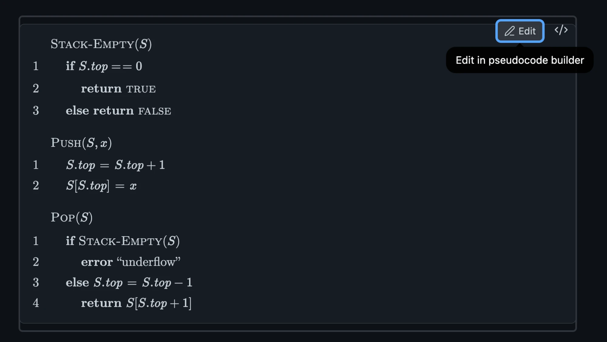
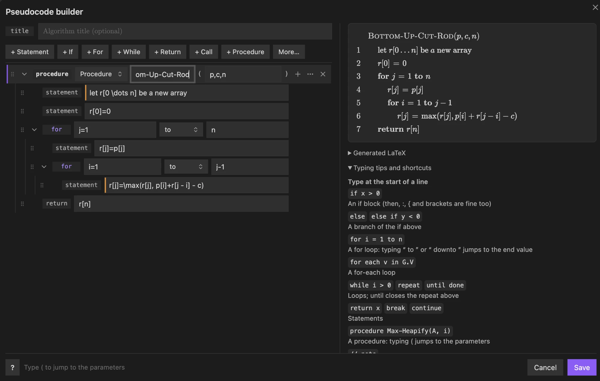

# Pseudocode Suite

Write algorithms the way *Introduction to Algorithms* (CLRS) prints them, without fighting LaTeX.

- **Renders** ` ```pseudo ` code blocks (an algorithmicx-style LaTeX subset) in CLRS typography: bold keywords, numbered lines, small-caps procedure names and constants, aligned `//` comments, Computer Modern fonts.
- **Builds** them visually. Type `if x > 0`, `for i = 1 to n` or `else` and the line becomes the block you meant. Paste pseudocode from anywhere (Python, C, CLRS with line numbers, LaTeX) and it is parsed into rows. A live preview shows the result.
- **Edits** any existing block in place, including blocks inside callouts, quotes and Canvas cards.
- **Converts** a selection or a code block (Python, C, Java, Pascal, Chinese pseudocode…) into a pseudocode block, and **copies** any block as LaTeX for a paper (`algorithm` + `algpseudocode`).



[中文说明](README.zh-CN.md)

## Getting started

1. Open a note and run **Insert pseudocode block** from the command palette, or click the ribbon icon. The builder opens.
2. Give the algorithm a title (optional) and press <kbd>Enter</kbd>.
3. Type the first line, for example `procedure Insertion-Sort(A, n)`, and keep going. Each <kbd>Enter</kbd> starts a new line; the preview on the right updates as you type.
4. Press <kbd>Ctrl/Cmd</kbd>+<kbd>Enter</kbd> or click **Save**. The block is inserted at the cursor.



To change a block later, hover over it in reading view or Live Preview and click **Edit**. In the source editor, put the cursor inside the block and run **Edit pseudocode block under cursor**, or use the right-click menu.

To turn existing code into pseudocode, select it (or put the cursor in a code block) and run **Convert selection or code block to pseudocode**; the builder opens with it parsed, and **Save** replaces it with a ` ```pseudo ` block. The copy icon next to **Edit** (or **Copy pseudocode block as LaTeX**) puts standard LaTeX on the clipboard, with the `\usepackage` lines it needs in a comment on top.

The builder has a **Typing tips and shortcuts** panel under the preview, and the line at the bottom of the builder always says what the keyboard does in the field you are in.

## Building by typing

You never have to reach for the toolbar. Type at the start of a line:

| Type | You get |
|---|---|
| `if x > 0` | An if block. `then`, `:`, `{` and brackets around the condition are removed. |
| `else`, `else x = 0` | An else branch on the if above (with its first statement). |
| `else if y < 0` (also `elseif`, `elif`) | Another branch on the if above. |
| `for i = 1 to n` | A for loop. Typing ` to ` or ` downto ` moves you to the end value. |
| `for each v in G.V` (also `for v ∈ S`) | A for-each loop. |
| `while i > 0` | A while loop. |
| `repeat` … `until done` | A repeat loop; the `until` line closes it. |
| `loop` | An endless loop (leave it with `break` or `return`). |
| `switch x`, then `case 1:` / `default:` (also `match`, `case _:`) | A switch; typing `case` on a line inside a case starts the next case. |
| `parallel for i = 1 to n`; `spawn`, `sync` | CLRS multithreaded pseudocode (`spawn` and `sync` are bold). |
| `for (int i = 0; i < n; i++)`, `for i in range(1, n + 1)` | A counting loop with CLRS bounds (`i = 0 to n - 1`, `i = 1 to n`). |
| `return x`, `print x`, `break`, `continue` | The matching statement. |
| `procedure Max-Heapify(A, i)` (also `function`, `def`, `algorithm`) | A procedure; typing `(` moves you to the parameters. |
| `Input: …`, `Output: …` (also `Require:`, `Ensure:`) | Require / Ensure lines. |
| `// note` | A comment line, numbered like in CLRS. |
| `x = 0 // note` | A trailing comment: typing ` // ` moves the rest into the comment field. |
| `end`, `end if`, `}` | Leaves the current block. |
| `如果 x > 0 则`, `否则`, `否则如果`, `当 i > 0 时`, `对于 i = 1 到 n`, `对每个 v ∈ V`, `重复` … `直到`, `返回`, `过程`, `输入：`, `输出：` | Chinese keywords work the same way. |

Conversions only happen when you type the keyword, so editing old text that happens to start with `for` changes nothing. They wait while an input method is composing. <kbd>Ctrl/Cmd</kbd>+<kbd>Z</kbd> undoes just the conversion and keeps your text.

### Keys

| Key | Action |
|---|---|
| <kbd>Enter</kbd> | New line. On a block head: the first line inside it. On an empty last line: leave the block. |
| <kbd>Shift</kbd>+<kbd>Enter</kbd> | New line after the current one, even on a block head. |
| <kbd>Backspace</kbd> | On an empty line: delete it. At the start of a block head: turn it back into a plain line (its contents stay). |
| <kbd>Tab</kbd> / <kbd>Shift</kbd>+<kbd>Tab</kbd> | Indent into the block above / outdent (also <kbd>Ctrl/Cmd</kbd>+<kbd>]</kbd> / <kbd>[</kbd>). |
| <kbd>↑</kbd> / <kbd>↓</kbd> | Previous / next field. |
| <kbd>Alt/⌥</kbd>+<kbd>↑</kbd> / <kbd>↓</kbd> | Move the line. |
| <kbd>Ctrl/Cmd</kbd>+<kbd>/</kbd> | Show the comment field (or remove an empty one). |
| <kbd>Ctrl/Cmd</kbd>+<kbd>Shift</kbd>+<kbd>D</kbd> / <kbd>K</kbd> | Duplicate / delete the line. |
| <kbd>Ctrl/Cmd</kbd>+<kbd>Z</kbd>, <kbd>Ctrl/Cmd</kbd>+<kbd>Shift</kbd>+<kbd>Z</kbd> | Undo, redo. |
| <kbd>Ctrl/Cmd</kbd>+<kbd>Enter</kbd> | Save and close. |
| <kbd>Esc</kbd> | Close (asks first if there are unsaved changes). |

On phones and tablets the toolbar has **⇤** / **⇥** buttons in place of <kbd>Tab</kbd> / <kbd>Shift</kbd>+<kbd>Tab</kbd>.

With the mouse: the toolbar adds any statement type, each row has **+**, **⋯** (more actions) and **✕** buttons, rows can be dragged by their **⠿** handle, and block rows can be collapsed.

### Pasting

Paste several lines into any line, or into the title, and they become rows:

- **Code and indented pseudocode**: Python (`def`, `elif`, `range()`, `//`, docstrings, `match`), C / Java / JavaScript (`{ }` in any brace style, `;`, an `if` without braces owning one statement, `for (;;)`, `do … while`, `switch`), Pascal (`begin` / `end`) or `end if` / `end while` style. Types in declarations and parameters (`int x = 0`, `def f(a: int) -> int`) are dropped; one-line `if x: return y` is split. Markdown code fences around the text are ignored.
- **Chinese pseudocode** (`如果` / `否则` / `当` / `对于` / `返回` …).
- **CLRS text** with line numbers: the numbers are dropped, `INSERTION-SORT(A)` becomes the procedure header (named Insertion-Sort; acronyms such as BFS stay upper case), and `←`, `≠`, `≤`, `≥` are converted.
- **LaTeX** (`\State`, `\If{…}`, …) is read like a saved block.

Text with neither indentation nor end markers (for example copied from a PDF) comes in flat; fix the levels with <kbd>Tab</kbd>.

### Writing expressions

Builder fields are typeset as math automatically; no `$…$` needed.

| Write | Shown as |
|---|---|
| `x = 1` (also `:=`, `<-`, `←`) | Assignment `x = 1` |
| `x == 0`; a single `=` in a condition | The narrow CLRS `==` |
| `<=`, `>=`, `!=` | ≤, ≥, ≠ |
| `and`, `or`, `not` (also `&&`, `\|\|`) | Upright words, as in CLRS |
| `NIL`, `TRUE`, `FALSE` (any all-caps word) | Small caps |
| `Merge-Sort(A, p, r)` | A call: capitalized name before `(`, set in small caps |
| `key`, `heap-size` | Multi-letter names in italic |
| `max(a, b)`, `lg n`, `x mod y` | Upright operators |
| `A[1..n]` | The CLRS range dots |
| `floor(n/2)`, `ceil(x)`, `sqrt(n)`, `abs(x)` | ⌊n/2⌋, ⌈x⌉, √n, \|x\| |
| `inf`, `infinity`, `∞` | ∞ |
| `None`, `null`, `nil` | NIL |
| `n**2`, `!done` | n², not *done* |
| `i % 2`, `S ∪ {u}`, `heap_size`, `a & b`, `cost $5` | Exactly these characters (`heap_size` is one italic name) |
| `error "heap underflow"` | **error** “heap underflow” |
| `exchange A[i] with A[j]` | A phrase: words upright, spaces kept |

One-letter functions such as `T(n)` and method calls such as `S.empty()` stay math. A field that contains `\` or `$` is kept exactly as written.

## Writing blocks by hand

The builder saves ordinary text, so you can also write or edit blocks directly:

````markdown
```pseudo
\begin{algorithm}
\caption{Insertion sort}
\begin{algorithmic}
  \Procedure{Insertion-Sort}{$A, n$}
    \For{$j = 2$ \To $n$}
      \State $\mathit{key} = A[j]$
      \State \Comment{Insert $A[j]$ into the sorted subarray $A[1 \twodots j - 1]$.}
      \State $i = j - 1$
      \While{$i > 0$ and $A[i] > \mathit{key}$}
        \State $A[i + 1] = A[i]$
        \State $i = i - 1$
      \EndWhile
      \State $A[i + 1] = \mathit{key}$
    \EndFor
  \EndProcedure
\end{algorithmic}
\end{algorithm}
```
````

Supported commands:

- Structure: `\begin{algorithm}`, `\caption`, `\begin{algorithmic}`
- Procedures: `\Procedure` / `\EndProcedure`, `\Function` / `\EndFunction`
- Branches: `\If`, `\ElsIf` (or `\Elif`), `\Else`, `\EndIf`
- Loops: `\For` (with `to`, `downto`, `\To` or `\DownTo`), `\ForAll` / `\ForEach`, `\EndFor`, `\ParFor`, `\While` / `\EndWhile`, `\Repeat` / `\Until`, `\Loop` / `\EndLoop`
- Switch: `\Switch` / `\EndSwitch`, `\Case{…}` / `\Default` (`\EndCase` optional)
- Statements: `\State`, `\Statex` (an unnumbered line), `\Return`, `\Print`, `\Break`, `\Continue`, `\Require`, `\Ensure`, `\Input`, `\Output`
- Inline: `\Call{Name}{$args$}`, `\Comment{…}`, `\textsc{nil}`, `\twodots`, `\gets`, `\le`, `\ge`, `\ne`, `\mathit`, `\texttt`, `\ref{…}`, …
- Line options: `\label{name}` after a line, `% highlight` at the end of a line, `\setcounter{ALG@line}{k}`, `\begin{algorithmic}[1]` / `[0]` (see below)

An `\End…` that does not match the open block (a stray `\EndWhile` inside an if) is ignored instead of closing the wrong block.

Rules of thumb: math goes inside `$…$` (text outside it stays text); write calls as `\Call{…}{…}` outside math (`\State $x \gets$ \Call{Extract-Min}{$Q$}`); write `and` / `or` between math runs (`\If{$a < 0$ and $b > 0$}`). Commands the plugin does not know are kept as raw lines.

### Block options

Set these in the builder (the **Line numbers** and **Start at** fields, and **Highlight line** / **Label for \ref…** in a row's **⋯** menu) or by hand:

| Write | Effect |
|---|---|
| `\begin{algorithmic}[1]` / `[0]` | Line numbers always shown / hidden for this block, whatever the setting says. |
| `\setcounter{ALG@line}{4}` | Numbering continues from 5 (first line) or jumps (between lines). |
| `\State … \label{init}` and `line \ref{init}` | `\ref` shows the number of the labelled line, also across procedures. |
| `\State … % highlight` | The line gets a highlighted background. |

## How it looks

The typography follows CLRS, 3rd edition (the `clrscode3e` package):

- Keywords are bold (**if**, **elseif**, **while**, **for**, **to**, **return**); there is no *then* or *do*. In *for each*, only **for** is bold.
- Statements are numbered; procedure headers are not, and every procedure starts again at 1. Comment lines get a number too.
- The first plain statement of an else branch sits on the else line (`else A[k] = R[j]`).
- Procedure names and constants (NIL, TRUE) use real small-caps glyphs; variables are italic; comments start with a bold `//` and line up in their own column.
- Blocks use embedded Computer Modern fonts, so they look the same under any theme and in PDF export.

## Settings

- **Show line numbers**
- **Indent width**: per nesting level, for example `1.2em` or `16px`
- **Comment prefix**: shown before comments (default `//`)
- **Show typing tips in the builder**: open the tips panel when the builder starts

Rendered blocks redraw as soon as a setting changes.

## Compatibility

- Desktop and mobile. Blocks on Canvas cards render and can be edited with **Edit**.
- Only one plugin can render ` ```pseudo ` blocks. If another plugin (such as **Pseudocode**) already does, Pseudocode Suite shows a notice; turn the other plugin off and reload. Blocks written for that plugin keep working, and its settings are migrated automatically.

## Known limitations

- LaTeX commands outside the supported subset are shown as raw lines. `algorithm2e` syntax (`\KwIn`, `\eIf`, `\;`) is not supported.
- Pasted text without indentation or end markers cannot be nested automatically.
- Paste conversion is a best effort: C `for` loops with other steps than `++` / `--` keep their header as written, Python's `while … else` becomes a comment, and `goto` / labels stay plain statements.
- TeX typed into a field (`\cup`) is kept as written; it is not turned back into `∪`.

## Development

The plugin is plain JavaScript with no dependencies. `src/` holds the sources; `build.py` joins them into `main.js` and writes `styles.css` with the fonts embedded.

```bash
python3 build.py              # build main.js and styles.css
node tests/test-core.js       # parser, serializer, typed lines, paste
node tests/test-render.js     # numbering, else merge, comments, typography
node tests/test-builder.js    # builder keys, typing shortcuts, paste, hints
node tests/test-main.js       # locating blocks in notes, settings
python3 tools/make-fonts.py   # only when changing fonts (needs fonttools, brotli)
```

`test-core.js` also round-trips every ` ```pseudo ` block it finds in your vaults (and in the folders listed in `PS_VAULTS`). Implementation notes are in [DEVELOPMENT.md](DEVELOPMENT.md).

## License

[MIT](LICENSE). The embedded fonts are subsets of CMU Serif (SIL Open Font License 1.1) and LM Roman Caps (GUST Font License); see [fonts/LICENSE.md](fonts/LICENSE.md).
