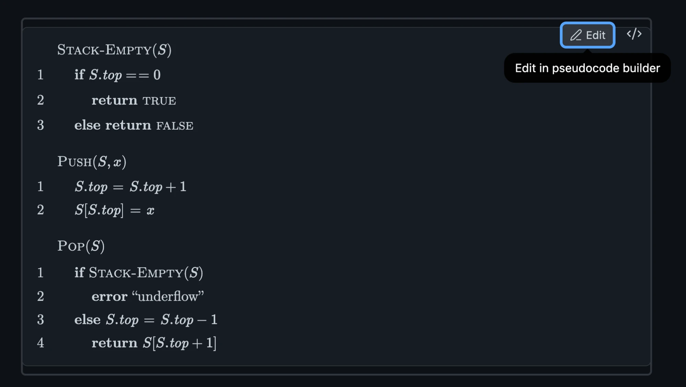
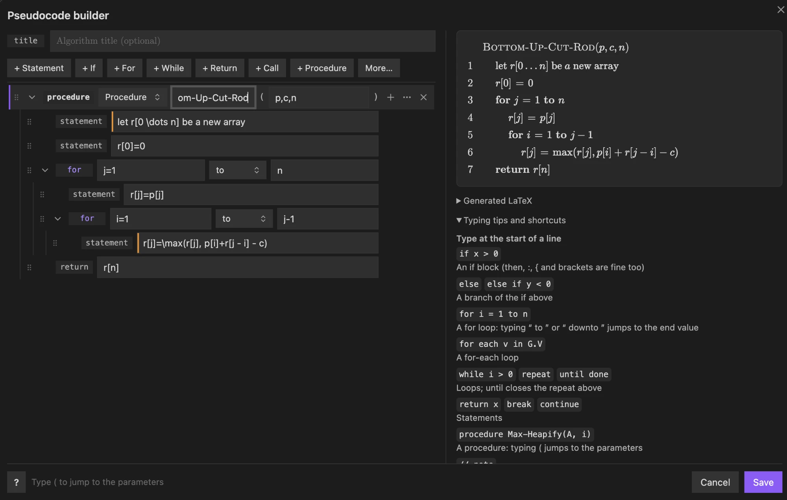

# Pseudocode Suite

像《算法导论》（CLRS）那样写算法，而不用和 LaTeX 较劲。

- **渲染** ` ```pseudo ` 代码块（algorithmicx 风格的 LaTeX 子集），排版同 CLRS：关键字粗体、行号、过程名和常量用小型大写、`//` 注释对齐、Computer Modern 字体。
- **可视化搭建**：打 `if x > 0`、`for i = 1 to n`、`else`，这一行就变成对应的块；从任何地方粘贴伪代码（Python、C、带行号的 CLRS、LaTeX）会自动解析成行。右侧实时预览。
- **就地编辑**已有的块，callout、引用和 Canvas 卡片里的块也可以。
- **转换**选中的文字或代码块（Python、C、Java、Pascal、中文伪代码……）为伪代码块；把任意块**复制成 LaTeX**（`algorithm` + `algpseudocode`），直接放进论文。



[English](README.md)

## 快速上手

1. 打开一篇笔记，在命令面板运行 **Insert pseudocode block**（或点左侧功能区图标），打开搭建器。
2. 填标题（可不填），按 <kbd>Enter</kbd>。
3. 输入第一行，例如 `procedure Insertion-Sort(A, n)`，然后接着写。每按一次 <kbd>Enter</kbd> 开一行，右侧预览实时更新。
4. 按 <kbd>Ctrl/Cmd</kbd>+<kbd>Enter</kbd> 或点 **Save**，块插入到光标处。



以后要改：在阅读视图或 Live Preview 里把鼠标移到块上，点 **Edit**。源码模式下把光标放进块里，运行 **Edit pseudocode block under cursor**，或用右键菜单。

要把现成的代码变成伪代码：选中它（或把光标放进代码块），运行 **Convert selection or code block to pseudocode**，搭建器会打开解析好的结果，**Save** 后原文换成 ` ```pseudo ` 块。**Edit** 旁边的复制图标（或命令 **Copy pseudocode block as LaTeX**）把标准 LaTeX 放进剪贴板，开头的注释里列出需要的 `\usepackage`。

搭建器里预览下方有 **Typing tips and shortcuts** 面板；底部提示栏会随光标所在的输入框说明此刻按键的作用。

## 边打边建

不需要点工具栏。在一行开头输入：

| 输入 | 得到 |
|---|---|
| `if x > 0` | if 块。条件外的 `then`、`:`、`{` 和括号会去掉 |
| `else`、`else x = 0` | 上方 if 的 else 分支（可直接带第一句） |
| `else if y < 0`（也认 `elseif`、`elif`） | 上方 if 的新分支 |
| `for i = 1 to n` | for 循环；打出 ` to ` 或 ` downto ` 时光标跳到终值 |
| `for each v in G.V`（也认 `for v ∈ S`） | for each 循环 |
| `while i > 0` | while 循环 |
| `repeat` … `until done` | repeat 循环，`until` 这行把它收尾 |
| `loop` | 无条件循环（用 `break` 或 `return` 退出） |
| `switch x`，然后 `case 1:` / `default:`（也认 `match`、`case _:`） | switch；在某个 case 里的一行打 `case` 会开始下一个 case |
| `parallel for i = 1 to n`；`spawn`、`sync` | CLRS 多线程伪代码（`spawn`、`sync` 粗体） |
| `for (int i = 0; i < n; i++)`、`for i in range(1, n + 1)` | 换成 CLRS 上下界的计数循环（`i = 0 to n - 1`、`i = 1 to n`） |
| `return x`、`print x`、`break`、`continue` | 对应语句 |
| `procedure Max-Heapify(A, i)`（也认 `function`、`def`、`algorithm`） | 过程；打 `(` 跳到参数 |
| `Input: …`、`Output: …`（也认 `Require:`、`Ensure:`） | Require / Ensure 行 |
| `// 说明` | 单独一行注释（和 CLRS 一样占一个行号） |
| `x = 0 // 说明` | 行尾注释：打出 ` // ` 时后面的内容移进注释框 |
| `end`、`end if`、`}` | 退出当前块 |
| `如果 x > 0 则`、`否则`、`否则如果`、`当 i > 0 时`、`对于 i = 1 到 n`、`对每个 v ∈ V`、`重复` … `直到`、`返回`、`过程`、`输入：`、`输出：` | 中文关键字同样会转换 |

只在“刚打出”关键字时转换，编辑本来就以 `for` 开头的旧文字不会被改；中文输入法组字时不触发。<kbd>Ctrl/Cmd</kbd>+<kbd>Z</kbd> 只撤回这次转换，文字保留。

### 按键

| 键 | 作用 |
|---|---|
| <kbd>Enter</kbd> | 新起一行；在块头上：进入块的第一行；在空的最后一行上：退出当前块 |
| <kbd>Shift</kbd>+<kbd>Enter</kbd> | 在当前行后面新起一行（块头也一样） |
| <kbd>Backspace</kbd> | 空行上：删除这行；块头输入框开头：退回普通行（块里的内容保留） |
| <kbd>Tab</kbd> / <kbd>Shift</kbd>+<kbd>Tab</kbd> | 缩进进上方的块 / 取消缩进（也可用 <kbd>Ctrl/Cmd</kbd>+<kbd>]</kbd> / <kbd>[</kbd>） |
| <kbd>↑</kbd> / <kbd>↓</kbd> | 上一个 / 下一个输入框 |
| <kbd>Alt/⌥</kbd>+<kbd>↑</kbd> / <kbd>↓</kbd> | 上下移动当前行 |
| <kbd>Ctrl/Cmd</kbd>+<kbd>/</kbd> | 显示注释框（空注释则移除） |
| <kbd>Ctrl/Cmd</kbd>+<kbd>Shift</kbd>+<kbd>D</kbd> / <kbd>K</kbd> | 复制 / 删除当前行 |
| <kbd>Ctrl/Cmd</kbd>+<kbd>Z</kbd>、<kbd>Ctrl/Cmd</kbd>+<kbd>Shift</kbd>+<kbd>Z</kbd> | 撤销、重做 |
| <kbd>Ctrl/Cmd</kbd>+<kbd>Enter</kbd> | 保存并关闭 |
| <kbd>Esc</kbd> | 关闭（有未保存修改时先确认） |

手机和平板上没有 <kbd>Tab</kbd>，工具栏多了 **⇤** / **⇥** 两个按钮。

鼠标操作：工具栏可以加任意类型的语句；每行右侧有 **+**、**⋯**（更多操作）、**✕**；拖动行首 **⠿** 排序；块可以折叠。

### 粘贴

在任意一行或标题框里粘贴多行文字，会直接建成结构：

- **代码和有缩进的伪代码**：Python（`def`、`elif`、`range()`、`//`、docstring、`match`）、C / Java / JavaScript（各种大括号风格、`;`、不带大括号的 `if` 只管下一句、`for (;;)`、`do … while`、`switch`）、Pascal（`begin` / `end`）、`end if` / `end while` 风格。声明和参数里的类型（`int x = 0`、`def f(a: int) -> int`）会去掉；单行的 `if x: return y` 会拆开；外面包着的 Markdown 代码围栏会忽略。
- **中文伪代码**（`如果` / `否则` / `当` / `对于` / `返回` 等）。
- **CLRS 原文**（带行号）：去掉行号；`INSERTION-SORT(A)` 识别为过程标题，名字改成 Insertion-Sort（BFS 等缩写保留）；`←`、`≠`、`≤`、`≥` 自动转换。
- **LaTeX**（`\State`、`\If{…}` 等）按已保存的块解析。

既没缩进也没有 end 的文字（比如从 PDF 复制的）没法判断层级，会排成一层，再用 <kbd>Tab</kbd> 调整。

### 表达式写法

搭建器的输入框自动按数学排版，不用写 `$…$`。

| 写 | 显示 |
|---|---|
| `x = 1`（也认 `:=`、`<-`、`←`） | 赋值 `x = 1` |
| `x == 0`；条件里的单个 `=` | CLRS 的窄 `==` |
| `<=`、`>=`、`!=` | ≤、≥、≠ |
| `and`、`or`、`not`（也认 `&&`、`\|\|`） | 正体单词，同 CLRS |
| `NIL`、`TRUE`、`FALSE`（任意全大写词） | 小型大写 |
| `Merge-Sort(A, p, r)` | 调用：大写开头的名字后跟 `(`，名字用小型大写 |
| `key`、`heap-size` | 多字母变量名斜体 |
| `max(a, b)`、`lg n`、`x mod y` | 正体运算符 |
| `A[1..n]` | CLRS 的区间两点 |
| `floor(n/2)`、`ceil(x)`、`sqrt(n)`、`abs(x)` | ⌊n/2⌋、⌈x⌉、√n、\|x\| |
| `inf`、`infinity`、`∞` | ∞ |
| `None`、`null`、`nil` | NIL |
| `n**2`、`!done` | n²、not *done* |
| `i % 2`、`S ∪ {u}`、`heap_size`、`a & b`、`cost $5` | 原样显示这些字符（`heap_size` 是一个斜体变量名） |
| `error "heap underflow"` | **error** “heap underflow” |
| `exchange A[i] with A[j]` | 短语：单词正体，保留空格 |

单字母函数（`T(n)`）和方法调用（`S.empty()`）仍按数学处理。输入框里出现 `\` 或 `$` 时按原样保留。

## 手写块

搭建器保存的是普通文本，也可以直接手写或修改：

````markdown
```pseudo
\begin{algorithm}
\caption{Insertion sort}
\begin{algorithmic}
  \Procedure{Insertion-Sort}{$A, n$}
    \For{$j = 2$ \To $n$}
      \State $\mathit{key} = A[j]$
      \State \Comment{Insert $A[j]$ into the sorted subarray $A[1 \twodots j - 1]$.}
      \State $i = j - 1$
      \While{$i > 0$ and $A[i] > \mathit{key}$}
        \State $A[i + 1] = A[i]$
        \State $i = i - 1$
      \EndWhile
      \State $A[i + 1] = \mathit{key}$
    \EndFor
  \EndProcedure
\end{algorithmic}
\end{algorithm}
```
````

支持的命令：

- 结构：`\begin{algorithm}`、`\caption`、`\begin{algorithmic}`
- 过程：`\Procedure` / `\EndProcedure`、`\Function` / `\EndFunction`
- 分支：`\If`、`\ElsIf`（或 `\Elif`）、`\Else`、`\EndIf`
- 循环：`\For`（`to`、`downto`、`\To`、`\DownTo`）、`\ForAll` / `\ForEach`、`\EndFor`、`\ParFor`、`\While` / `\EndWhile`、`\Repeat` / `\Until`、`\Loop` / `\EndLoop`
- switch：`\Switch` / `\EndSwitch`、`\Case{…}` / `\Default`（`\EndCase` 可省略）
- 语句：`\State`、`\Statex`（不编号的行）、`\Return`、`\Print`、`\Break`、`\Continue`、`\Require`、`\Ensure`、`\Input`、`\Output`
- 行内：`\Call{Name}{$args$}`、`\Comment{…}`、`\textsc{nil}`、`\twodots`、`\gets`、`\le`、`\ge`、`\ne`、`\mathit`、`\texttt`、`\ref{…}` 等
- 行选项：行尾的 `\label{name}`、行尾的 `% highlight`、`\setcounter{ALG@line}{k}`、`\begin{algorithmic}[1]` / `[0]`（见下）

和当前块对不上的 `\End…`（比如 if 里多出来的 `\EndWhile`）会被忽略，不会错关别的块。

几条规则：数学放在 `$…$` 里（外面的是普通文字）；调用写成 `\Call{…}{…}`，放在数学外面（`\State $x \gets$ \Call{Extract-Min}{$Q$}`）；`and` / `or` 写在两段数学之间（`\If{$a < 0$ and $b > 0$}`）。不认识的命令按原样保留成 raw 行。

### 块选项

可以在搭建器里设置（**Line numbers**、**Start at** 两个字段，以及每行 **⋯** 菜单里的 **Highlight line** / **Label for \ref…**），也可以手写：

| 写 | 效果 |
|---|---|
| `\begin{algorithmic}[1]` / `[0]` | 这个块总是显示 / 隐藏行号，不管设置里怎么选 |
| `\setcounter{ALG@line}{4}` | 编号从 5 开始（放在第一行前），或在中间跳号 |
| `\State … \label{init}` 和 `line \ref{init}` | `\ref` 显示被标记那一行的行号，跨过程也可以 |
| `\State … % highlight` | 这一行加高亮底色 |

## 排版

以 CLRS 第 3 版（`clrscode3e`）为准：

- 关键字粗体（**if**、**elseif**、**while**、**for**、**to**、**return**），不写 then / do；for each 只有 **for** 加粗。
- 语句编号；过程标题不编号，每个过程从 1 重新编号；注释行也编号。
- else 分支的第一句是普通语句时并到 else 行（`else A[k] = R[j]`）。
- 过程名和常量（NIL、TRUE）用真正的小型大写字形；变量斜体；注释以粗体 `//` 开头，在单独一栏对齐。
- 使用内嵌的 Computer Modern 字体，任何主题下、导出 PDF 时都一样。

## 设置

- **Show line numbers**：显示行号
- **Indent width**：每层缩进宽度，如 `1.2em`、`16px`
- **Comment prefix**：注释前缀（默认 `//`）
- **Show typing tips in the builder**：打开搭建器时展开提示面板

修改设置后，已渲染的块会立即重绘。

## 兼容性

- 桌面端和移动端都可用。Canvas 卡片里的块同样渲染，也能点 **Edit** 编辑。
- 同一种代码块只能由一个插件渲染。如果另一个插件（如 **Pseudocode**）已经接管了 ` ```pseudo `，会弹出提示；关掉那个插件并重新加载即可。为它写的块照常可用，它的设置会自动迁移。

## 已知限制

- 不在支持范围内的 LaTeX 命令显示为 raw 行；不支持 `algorithm2e` 语法（`\KwIn`、`\eIf`、`\;`）。
- 既没缩进也没有 end 的粘贴文字无法自动分层。
- 粘贴转换尽力而为：步长不是 `++` / `--` 的 C `for` 保留原写法，Python 的 `while … else` 变成一行注释，`goto` / 标号保持普通语句。
- 输入框里手写的 TeX（如 `\cup`）原样保留，不会换回 `∪`。

## 开发

见 [README.md](README.md#development) 的 Development 一节和 [DEVELOPMENT.md](DEVELOPMENT.md)。

## 许可

[MIT](LICENSE)。内嵌字体是 CMU Serif（SIL Open Font License 1.1）和 LM Roman Caps（GUST Font License）的子集，见 [fonts/LICENSE.md](fonts/LICENSE.md)。
